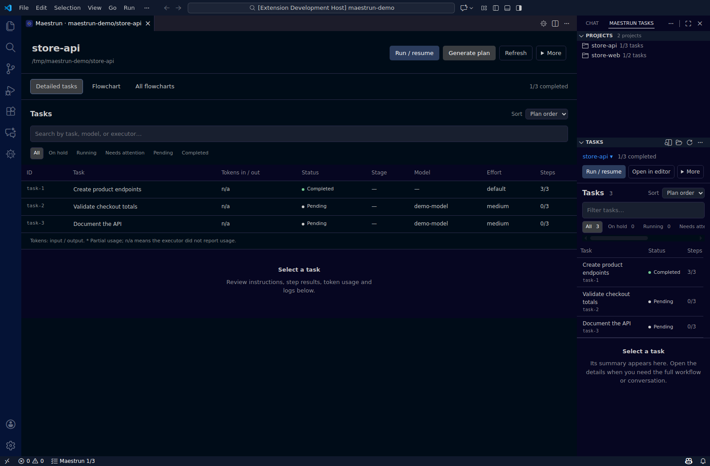

# Maestrun for VS Code

**[Download latest](https://github.com/maestrun/vscode-extension/releases/latest)** · [Website](https://maestrun.com) · [Quick guide](docs/usage.md) · [Português](docs/guia-pt-br.md)

**Orchestrator inside VS Code:** coordinate predefined or agent-created tasks, inspect nested dependencies and every task’s steps, and resume saved work. Configure workflows, generate plans, and run tasks from your editor.



*Version 1.0.0. Real interface with demonstration data; no paid model run is shown.*

## Install

1. Install **Node.js 24 LTS** and an authenticated executor supported by Maestrun.
2. Install the latest stable CLI:

   ```sh
   npm install --global @maestrun/maestrun@latest
   ```

3. Download `maestrun-vscode-1.1.0.vsix` from the [latest release](https://github.com/maestrun/vscode-extension/releases/latest).
4. In VS Code, run **Extensions: Install from VSIX…** and select the file.
5. Open your project folder and click the **Maestrun** icon.

Requires **VS Code 1.106+** and a trusted workspace. Use Linux, macOS, WSL, or SSH. On Windows, open the project through **WSL**. Install the CLI and executor in the same environment as your project.

Extension **1.1.0** supports Orchestrator with CLI **0.1.1**, installed separately. Use `@latest` when installing or updating the CLI. See [maestrun.com](https://maestrun.com) for CLI installation and product information.

## Run your first workflow

1. Open **More → Set up workflow**.
2. Choose your executor and model; select **Orchestrator** to coordinate tasks, or configure a standard workflow.
3. Click **Generate plan** and describe the work.
4. Review the tasks.
5. Click **Run / resume**.

**Try an example:** run **Maestrun: Run example** from the Command Palette. Examples use your executor account's usage.

## Find what you need

| Action | Where |
| --- | --- |
| Follow tasks | **Projects / Tasks** in the Secondary Side Bar |
| Inspect a step | **Flowchart** → click a stage |
| Compare projects | **All flowcharts** |
| Read an error | Expand the notice → **View execution log** |
| Remove a configuration or example | Hover a project → trash icon → confirm |

[Illustrated usage guide](docs/usage.md) · [Guia em português](docs/guia-pt-br.md) · [Development](docs/development.md)

## Help

- Missing CLI? Open [maestrun.com](https://maestrun.com), install it, then click **Refresh**.
- Hidden panel? Click the Maestrun icon or run **Maestrun: Open Maestrun**.
- Found a bug? [Open an issue](https://github.com/maestrun/vscode-extension/issues) with the error and extension/CLI versions. Remove secrets from logs before sharing.

[Release notes](CHANGELOG.md) · [Sustainable Use License 1.0](LICENSE)

## Orchestrator dependency flowcharts

With an orchestrator plan or agent run, **Flowchart** shows the main task on the **left** and every task once, after all its prerequisites. Arrows show all dependencies, including branches, convergences, cross-links and coordinated repairs. The navigation tree retains its grouping independently. **Horizontal** draws left to right; **Vertical** draws top to bottom, including the steps inside each task. The direction is remembered per diagram. **Simple** shows task boxes; **Detailed** embeds the complete step flowchart inside every task, including custom steps and Git integration. Select any task or step to inspect its results and conversation. The diagram scrolls within its panel, then scrolling continues into the compact step details below. Its detail mode and position survive live updates. **All flowcharts** uses the same dependency graph for each project.

The task table displays the same hierarchy as a directory tree, with collapsible branches. Sorting keeps children with their parents; filters retain ancestors to show where matches belong.

The extension reads `orchestration`, `dependsOn`, `parentId`, and per-task steps from the CLI report. Markdown plans use `Parent` and `Steps`; generated agent tasks remain visible when progress updates. **Run example** includes `orchestrator-plan` and `orchestrator-agent` (requires CLI 0.1.1 or later). Expanding or navigating diagrams makes no model calls.

## Choose tasks for the current run

**Run / resume** defaults to **All** unfinished tasks. Select **Choose tasks for this run** to check only the tasks you want to execute now. Completed tasks remain visible in gray with **(completed)** and cannot be selected again. Unchecked tasks keep their progress for later; the next run defaults to All again. Include unfinished dependencies in your selection, or finish them first.

The same selection reaches the background worker. With orchestration, a selected run executes the chosen existing tasks without generating additional work; choose All later to resume coordination. Parallel execution supports a parent folder without Git containing multiple repositories, using a separate set of child worktrees per task. Update the Maestrun CLI together with this extension to use these features.

Orchestrator setup also offers **Default orchestrator effort (agents can override)**. Change it later in the workflow table’s **Planning → Effort** field. Tasks and agents without an explicit effort inherit it when supported by their executor; an agent’s own effort takes priority.

For a parent workspace containing Git repositories, the first parallel **Run / resume** asks which repositories belong to the project. Select only those participating; Maestrun saves the list for this workspace and ignores other repositories on later runs. Empty Git placeholders and inaccessible directories are excluded from discovery. To choose again, remove `execution.repositories` from the project configuration.
