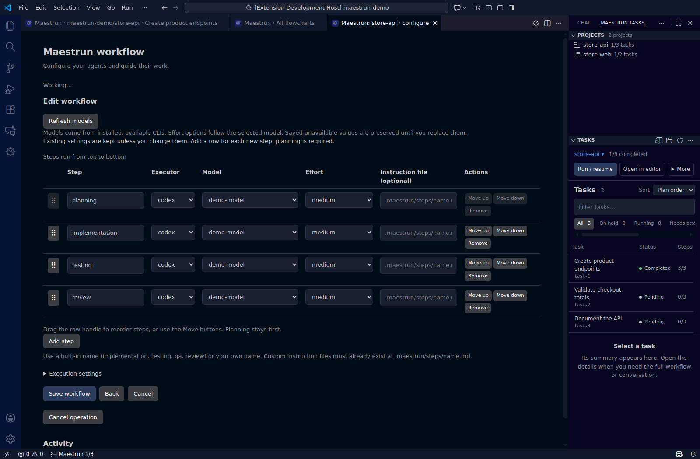

# Quick guide

**Start here:** [install the extension and CLI](../README.md#install).

## Configure a workflow

1. Open **More → Set up workflow**.
2. Choose an executor and model.
3. Save the workflow.

To change it later: **Configure workflow → Edit steps and execution in a table**. Set the model and effort per step; drag rows to reorder. Save to apply changes.

## Plan and run

1. Click **Generate plan**.
2. Enter requirements or choose a file.
3. Review tasks before execution.
4. Click **Run / resume**.

**Cancel execution** stops the run. Completed work is preserved. Closing the dashboard does not stop a background run.

## Inspect a task

1. Select a task in the sidebar.
2. Click **View details** to open its dashboard.
3. Choose **Flowchart** and click a stage for its results and logs.

| State | Next action |
| --- | --- |
| On hold | **Answer question**; resume if execution stopped |
| Failed | Read the error → **View execution log** |
| Running | Follow progress; **Send instructions** when an active model session is available |

For operation errors, the notification's **View logs** opens the Maestrun output channel.

## Run examples

1. Run **Maestrun: Run example** from the Command Palette.
2. Choose **Simple** or **Advanced**.
3. Select your executor/model and confirm.

**Simple:** two sequential tasks. **Advanced:** five tasks, approval, repair, Git integration, and an intentional failure. Answer `continue` when prompted. Advanced needs Git 2.38+ and ends **Failed** by design.

Examples use your executor account's usage. Terminal examples inside the workspace appear in **Projects** automatically, within about 10 seconds. Click **Refresh** to find them sooner.

## Switch projects

Click a project in **Projects** to update the sidebar. Use **Open in editor** for its own dashboard tab.

**All flowcharts** groups tasks by project:

Discovery finds `.maestrun/config.json` under workspace folders, including examples. Use **Select project → Choose another folder…** for a folder that needs setup.

## Remove an entry

1. Hover the project row.
2. Click the **trash icon**.
3. Check the path and confirm.

| Entry | What is removed |
| --- | --- |
| Regular project | Only `.maestrun/config.json`; source, plan, and history remain |
| Example | Its entire example folder, including history |

The **refresh icon** rescans projects. Both icons are also available in the project picker.

Stop active runs before removal. If Trash is unavailable on WSL/SSH, a second confirmation offers **Delete permanently**. Cancel to keep the files.

## Reopen the panel

Click the **Maestrun** Activity Bar icon or run **Maestrun: Open Maestrun**. Projects and Tasks start in the **Secondary Side Bar**; manual moves are remembered.

The editor toolbar shortcut and **More** menu also provide navigation. VS Code controls whether its bars and icons are hidden.

## Fix installation issues

| Problem | Action |
| --- | --- |
| CLI missing | Follow [maestrun.com](https://maestrun.com), then **Refresh** |
| CLI outside PATH | Set `maestrun.executable` to its executable or `dist/main.js`; no arguments |
| Node missing | Set `maestrun.nodeExecutable` to a supported Node executable |
| Different plan file | Set `maestrun.tasksFile`, relative to the project; default `plan.md` |
| WSL/SSH cannot find CLI | Install it remotely and use VS Code remote settings |

Tested with CLI **0.1.1-beta.5**. Other engine versions may require an extension update. Node support: `^22.13.0 || ^24.0.0 || >=26.0.0`.

*All images show extension 1.0.0 in VS Code with demonstration data.*
